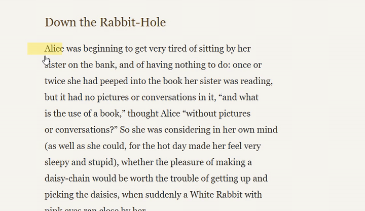
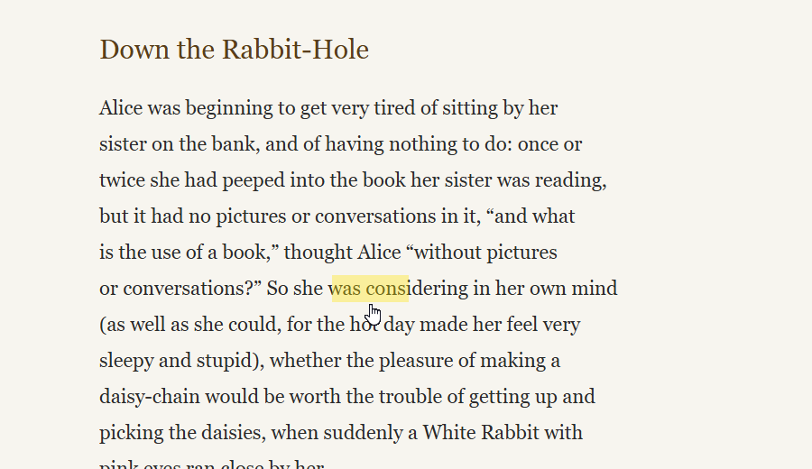
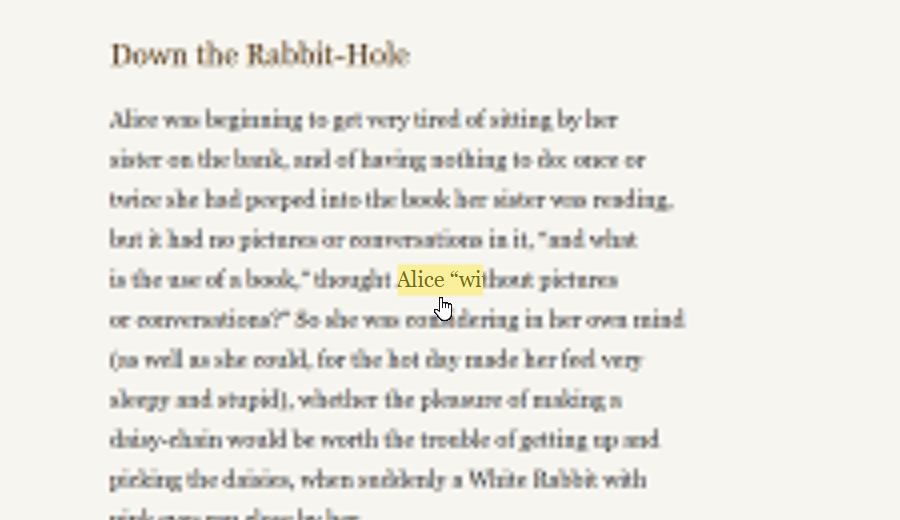
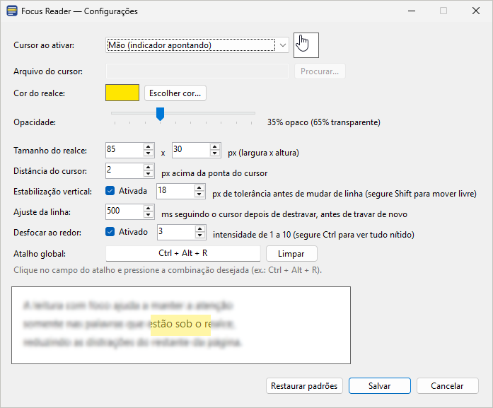
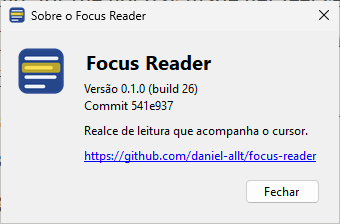

<p align="center">
  
</p>

<h1 align="center">Focus Reader</h1>

<p align="center">
  A reading highlight that follows your mouse cursor on Windows, so you can keep your eyes on the words you are reading.
</p>

<p align="center">
  <a href="https://github.com/daniel-allt/focus-reader/actions/workflows/build.yml"></a>
  <a href="https://github.com/daniel-allt/focus-reader/releases/latest"></a>
  <a href="https://github.com/daniel-allt/focus-reader/releases"></a>
  <a href="LICENSE"></a>
  
  
</p>

<p align="center">
  English · <a href="README.pt-BR.md">Português (Brasil)</a>
</p>

<p align="center">
  
</p>

Focus Reader lives in the system tray. Press a global hotkey and the cursor turns into a pointing hand with a translucent highlight just above the fingertip. Slide it along the line you are reading. The highlight doesn't block clicks, text selection or scrolling, so it works over any app: browsers, PDF readers, Word, and so on.

## Features

- **Reading highlight** that follows the cursor, with the color, opacity and size you choose (default 85 × 30 px).
- **Vertical stabilization:** the highlight stays on the current line while you move sideways, even if your hand drifts a little. Move further up or down and it follows you to the next line for a moment, then locks again where you stopped. Hold **Shift** to move it freely.
- **Blur surroundings (optional):** gently blurs the rest of the screen while keeping the next lines readable. Hold **Ctrl** to see everything sharp.
- **Global hotkey** to turn reading mode on and off from any app (default `Ctrl + Alt + R`).
- **Your own cursor:** hand, arrow, I-beam, other system cursors or any `.cur`/`.ani` file. Matches your Windows pointer size and scale, and your original cursor always comes back.
- Per-monitor DPI aware, single portable `.exe`, no installer.

| Highlight | Blur surroundings |
| --- | --- |
|  |  |

| Settings | About |
| --- | --- |
|  |  |

> The app's interface is currently in Portuguese (pt-BR).

## Download

Get the latest version from [Releases](https://github.com/daniel-allt/focus-reader/releases/latest):

| File | When to use |
| --- | --- |
| `FocusReader-win-x64-self-contained.zip` | Recommended. Runs on any 64-bit Windows 10/11, nothing else to install (~66 MB). |
| `FocusReader-win-x64.zip` | Smaller (~150 KB), requires the [.NET 8 Desktop Runtime](https://dotnet.microsoft.com/download/dotnet/8.0). |

Extract the zip and run `FocusReader.exe`. The icon appears in the tray, next to the clock.

**Windows SmartScreen warning:** the executable is not code-signed, so Windows may show a "Windows protected your PC" warning. Click **More info → Run anyway**, or, before extracting, right-click the `.zip` → **Properties** → check **Unblock**. You can also [build it yourself](#build-from-source).

## Usage

| Action | How |
| --- | --- |
| Turn reading mode on/off | `Ctrl + Alt + R` (configurable), or the tray menu |
| Move the highlight freely between lines | Hold `Shift` |
| See the screen without blur | Hold `Ctrl` |
| Settings | Tray icon → right-click → **Configurações...** (or double-click the icon) |
| Version and build | Tray icon → **Sobre...** |
| Exit | Tray icon → **Sair** |

## Settings

| Setting | Default | Description |
| --- | --- | --- |
| Cursor | Hand | Cursor shown while reading mode is on: system cursors, a `.cur`/`.ani` file, or keep the current one |
| Highlight color and opacity | Yellow, 35% | Any color, 5% to 95% opacity |
| Highlight size | 85 × 30 px | Width × height, scaled with display DPI |
| Distance from cursor | 2 px | Gap between the fingertip and the bottom of the highlight |
| Vertical stabilization | On, 18 px | How far the mouse must move vertically before the highlight leaves the line |
| Line adjustment | 500 ms | How long the highlight keeps following the cursor after unlocking, before locking again |
| Blur surroundings | Off, strength 3 | Strength from 1 to 10 |
| Global hotkey | `Ctrl + Alt + R` | Any combination with Ctrl/Alt/Shift/Win, or F1–F24 alone |

Settings are saved in `%APPDATA%\FocusReader\settings.json`.

## Privacy

Focus Reader makes no network connections and collects no data. When **Blur surroundings** is on, it captures the screen a few times per second to draw the blurred background. These captures stay in memory only and are never saved or sent anywhere.

## Limitations

- Windows only (Windows 10/11, 64-bit).
- Blur requires Windows 10 version 2004 or newer. While blur is on, the highlight and blur don't appear in screenshots or screen sharing.
- The blurred area refreshes a few times per second, so scrolling or video behind it shows a slight delay.
- Tested mainly on a single monitor. Reports from multi-monitor and mixed-scale setups are welcome.

## Build from source

Requires the [.NET 8 SDK](https://dotnet.microsoft.com/download/dotnet/8.0).

```powershell
dotnet run --project src/FocusReader
```

Single-file executable:

```powershell
# Requires the .NET 8 Desktop Runtime on the target machine
dotnet publish src/FocusReader -c Release -r win-x64 --self-contained false -p:PublishSingleFile=true -o publish

# Self-contained (no runtime needed)
dotnet publish src/FocusReader -c Release -r win-x64 --self-contained true -p:PublishSingleFile=true -p:EnableCompressionInSingleFile=true -o publish
```

GitHub Actions builds every push and pull request on `windows-latest`. Pushing a tag such as `v1.2.3` publishes a release: the version comes from the tag and the build number from the CI run, and both are shown in **Sobre...**. Local builds show "build local".

## Contributing

Bug reports, ideas and pull requests are welcome. See [CONTRIBUTING.md](CONTRIBUTING.md). To report a security issue, see [SECURITY.md](SECURITY.md).

## License

[MIT](LICENSE) © Daniel Santana
