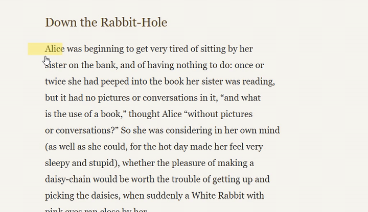
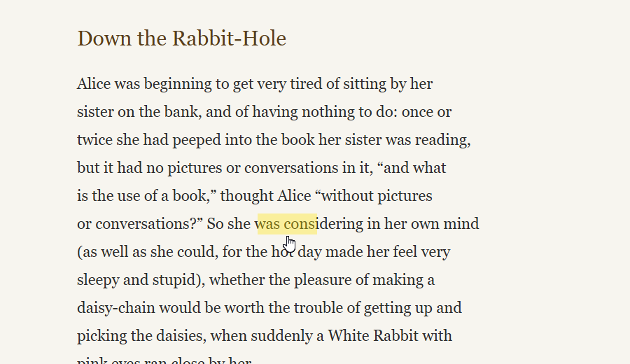
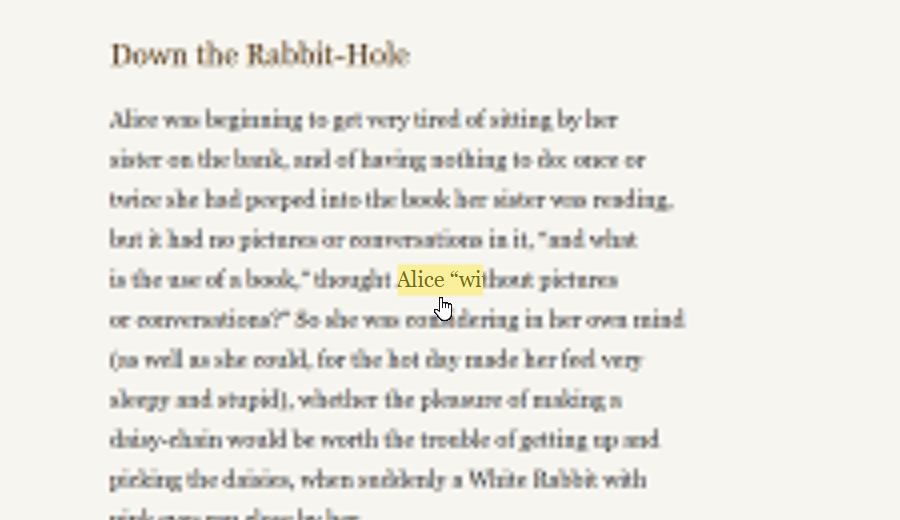
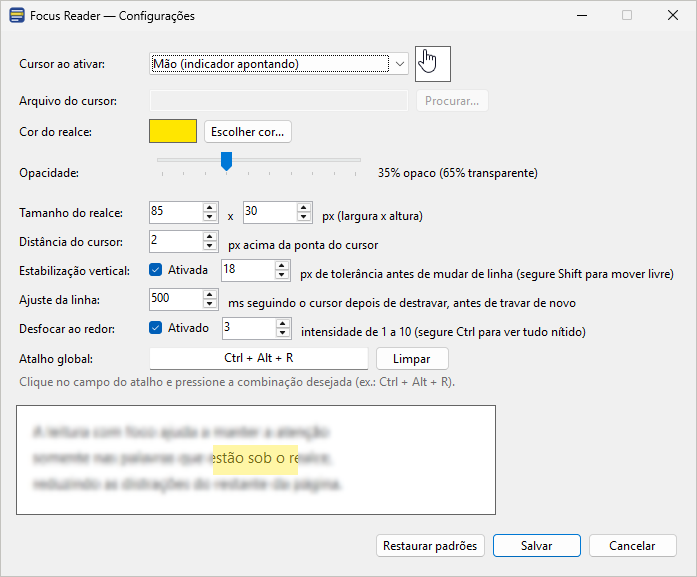
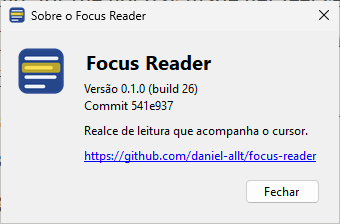

<p align="center">
  
</p>

<h1 align="center">Focus Reader</h1>

<p align="center">
  Um realce de leitura que acompanha o cursor do mouse no Windows, para manter os olhos nas palavras que você está lendo.
</p>

<p align="center">
  <a href="https://github.com/daniel-allt/focus-reader/actions/workflows/build.yml"></a>
  <a href="https://github.com/daniel-allt/focus-reader/releases/latest"></a>
  <a href="https://github.com/daniel-allt/focus-reader/releases"></a>
  <a href="LICENSE"></a>
  
  
</p>

<p align="center">
  <a href="README.md">English</a> · Português (Brasil)
</p>

<p align="center">
  
</p>

O Focus Reader fica na bandeja do sistema. Ao apertar um atalho global, o cursor vira uma mão com o indicador apontando e um realce transparente aparece logo acima da ponta do dedo. É só passar o realce pela linha que você está lendo. Ele não bloqueia cliques, seleção de texto nem rolagem, então funciona sobre qualquer programa: navegadores, leitores de PDF, Word etc.

## Funcionalidades

- **Realce de leitura** que acompanha o cursor, com a cor, a opacidade e o tamanho que você escolher (padrão 85 × 30 px).
- **Estabilização vertical:** o realce fica na linha atual enquanto você move o mouse na horizontal, mesmo que a mão desvie um pouco. Ao subir ou descer mais, ele acompanha o cursor até a próxima linha por um instante e trava de novo onde você parou. Segure **Shift** para movê-lo livremente.
- **Desfocar ao redor (opcional):** desfoca levemente o restante da tela, sem impedir de ver as próximas linhas. Segure **Ctrl** para ver tudo nítido.
- **Atalho global** para ligar e desligar o modo de leitura em qualquer programa (padrão `Ctrl + Alt + R`).
- **Cursor à sua escolha:** mão, seta, I-beam, outros cursores do sistema ou qualquer arquivo `.cur`/`.ani`. Respeita o tamanho do ponteiro e a escala configurados no Windows, e o seu cursor original sempre volta.
- Ajusta-se ao DPI de cada monitor; um único `.exe` portátil, sem instalador.

| Realce | Desfocar ao redor |
| --- | --- |
|  |  |

| Configurações | Sobre |
| --- | --- |
|  |  |

## Download

Baixe a versão mais recente em [Releases](https://github.com/daniel-allt/focus-reader/releases/latest):

| Arquivo | Quando usar |
| --- | --- |
| `FocusReader-win-x64-self-contained.zip` | Recomendado. Funciona em qualquer Windows 10/11 64 bits, sem instalar nada (~66 MB). |
| `FocusReader-win-x64.zip` | Menor (~150 KB), exige o [.NET 8 Desktop Runtime](https://dotnet.microsoft.com/download/dotnet/8.0). |

Extraia o zip e execute o `FocusReader.exe`. O ícone aparece na bandeja, perto do relógio.

**Aviso do SmartScreen:** o executável não tem assinatura digital, então o Windows pode mostrar o aviso "O Windows protegeu o computador". Clique em **Mais informações → Executar assim mesmo** ou, antes de extrair, clique com o botão direito no `.zip` → **Propriedades** → marque **Desbloquear**. Você também pode [compilar o app](#compilar).

## Como usar

| Ação | Como |
| --- | --- |
| Ligar/desligar o modo de leitura | `Ctrl + Alt + R` (configurável) ou o menu da bandeja |
| Mover o realce livremente entre linhas | Segure `Shift` |
| Ver a tela sem desfoque | Segure `Ctrl` |
| Configurações | Ícone da bandeja → botão direito → **Configurações...** (ou duplo clique no ícone) |
| Versão e build | Ícone da bandeja → **Sobre...** |
| Sair | Ícone da bandeja → **Sair** |

## Configurações

| Opção | Padrão | Descrição |
| --- | --- | --- |
| Cursor ao ativar | Mão | Cursor usado no modo de leitura: cursores do sistema, um arquivo `.cur`/`.ani` ou manter o atual |
| Cor e opacidade do realce | Amarelo, 35% | Qualquer cor, opacidade de 5% a 95% |
| Tamanho do realce | 85 × 30 px | Largura × altura, escalado pelo DPI da tela |
| Distância do cursor | 2 px | Espaço entre a ponta do dedo e a borda de baixo do realce |
| Estabilização vertical | Ligada, 18 px | Quanto o mouse precisa se mover na vertical para o realce sair da linha |
| Ajuste da linha | 500 ms | Por quanto tempo o realce segue o cursor depois de destravar, antes de travar de novo |
| Desfocar ao redor | Desligado, intensidade 3 | Intensidade de 1 a 10 |
| Atalho global | `Ctrl + Alt + R` | Qualquer combinação com Ctrl/Alt/Shift/Win, ou F1–F24 sozinhas |

As configurações ficam em `%APPDATA%\FocusReader\settings.json`.

## Privacidade

O Focus Reader não acessa a rede e não coleta nenhum dado. Com **Desfocar ao redor** ligado, ele captura a tela algumas vezes por segundo para desenhar o fundo desfocado. Essas capturas ficam só na memória e nunca são salvas nem enviadas.

## Limitações

- Só para Windows (Windows 10/11, 64 bits).
- O desfoque exige o Windows 10 versão 2004 ou mais recente. Com o desfoque ligado, o realce e o desfoque não aparecem em prints nem em compartilhamento de tela.
- A área desfocada é atualizada algumas vezes por segundo, então rolagem ou vídeo atrás dela aparecem com um pequeno atraso.
- Testado principalmente com um monitor. Relatos de uso com vários monitores ou escalas diferentes são bem-vindos.

## Compilar

Requer o [.NET 8 SDK](https://dotnet.microsoft.com/download/dotnet/8.0).

```powershell
dotnet run --project src/FocusReader
```

Executável único:

```powershell
# Requer o .NET 8 Desktop Runtime na máquina
dotnet publish src/FocusReader -c Release -r win-x64 --self-contained false -p:PublishSingleFile=true -o publish

# Autocontido (não requer runtime)
dotnet publish src/FocusReader -c Release -r win-x64 --self-contained true -p:PublishSingleFile=true -p:EnableCompressionInSingleFile=true -o publish
```

O GitHub Actions compila cada push e pull request no `windows-latest`. Criar uma tag como `v1.2.3` publica um release: a versão vem da tag e o número de build vem da execução do CI, e os dois aparecem em **Sobre...**. Builds locais mostram "build local".

## Contribuir

Relatos de bugs, ideias e pull requests são bem-vindos. Veja o [CONTRIBUTING.md](CONTRIBUTING.md) (em inglês). Para reportar um problema de segurança, veja o [SECURITY.md](SECURITY.md).

## Licença

[MIT](LICENSE) © Daniel Santana
